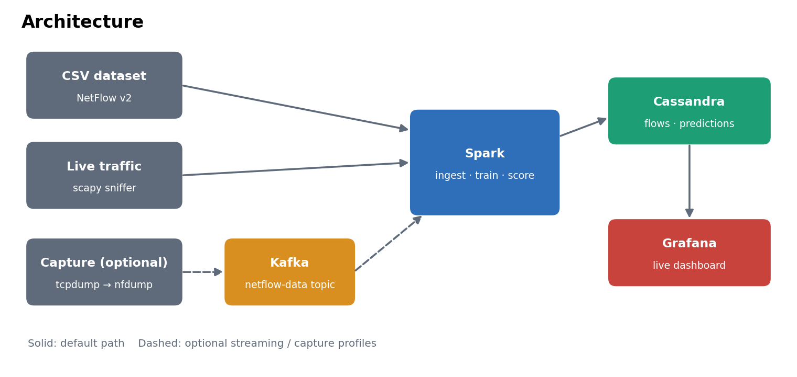
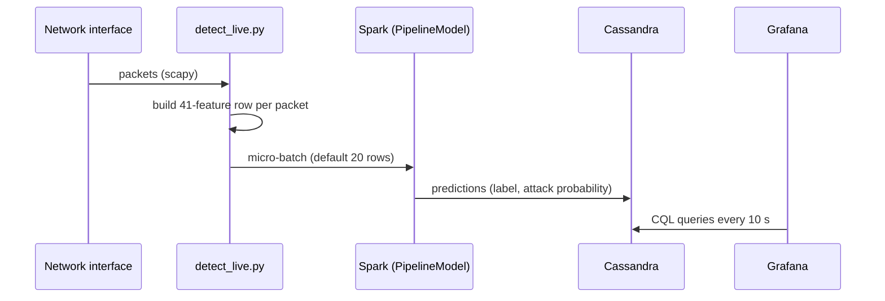
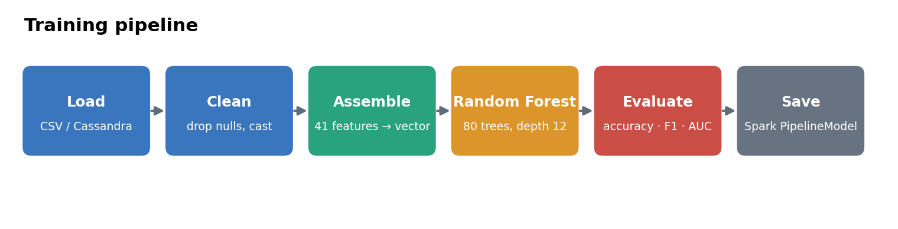
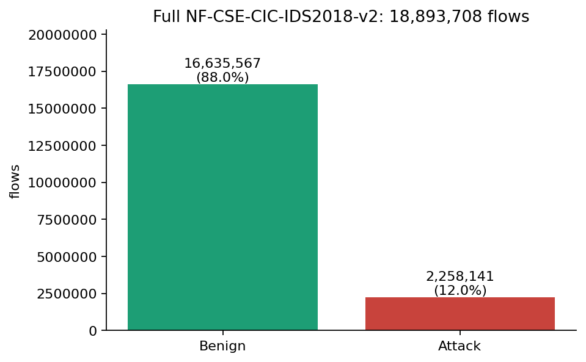
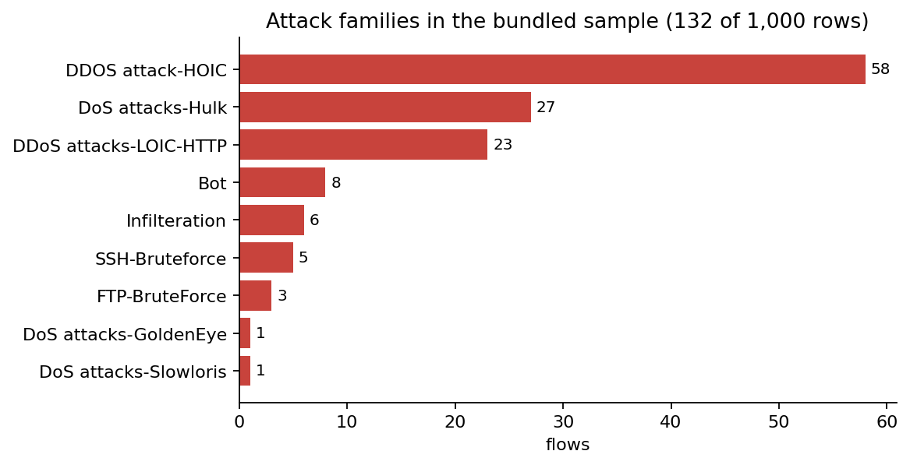
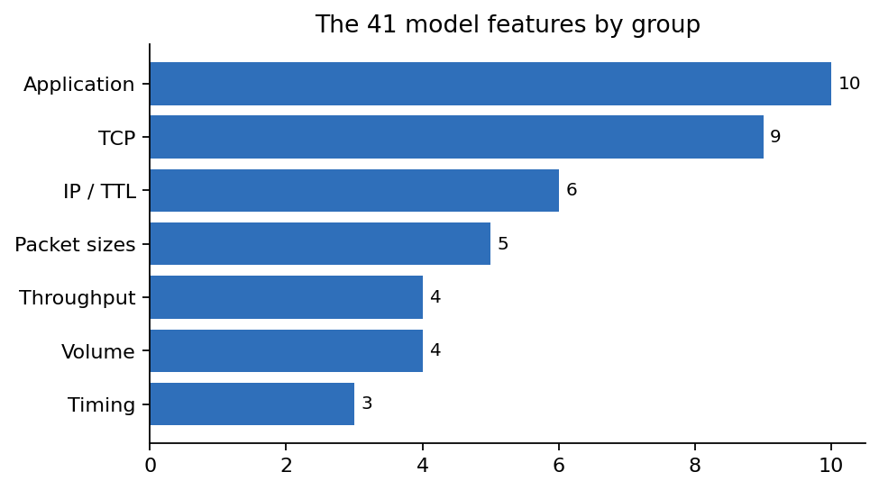
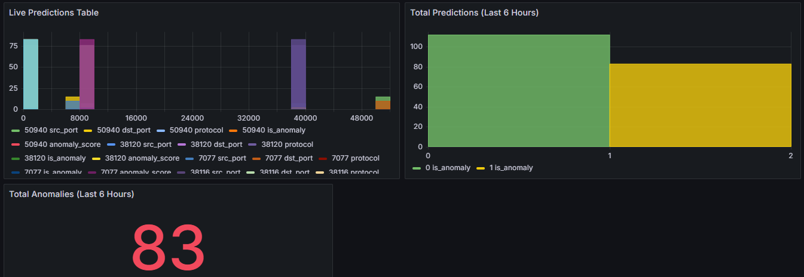
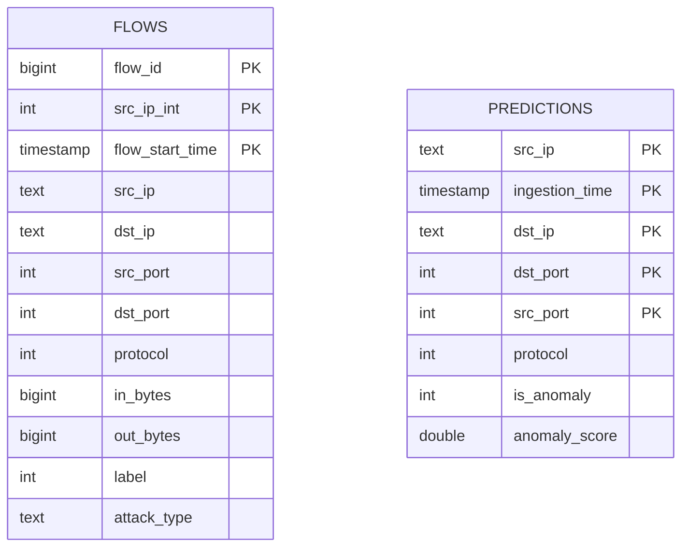

# NetFlow: network intrusion-detection pipeline

A compact, containerised **pipeline**. It trains a Random Forest on NetFlow records, scores live packets (or Kafka messages) in micro-batches with Apache Spark, stores every prediction in Apache Cassandra and visualises the results in Grafana.



## Features

- One command starts Cassandra, a Spark master/worker and Grafana; the schema is created automatically
- Batch ingestion of NetFlow CSV files into Cassandra
- Spark ML training pipeline (vector assembler + Random Forest) that saves a reusable `PipelineModel` and a `metrics.json`
- Live detection: packets are sniffed, converted to feature rows, scored in micro-batches and written to Cassandra
- Optional Kafka streaming path (Structured Streaming) and an optional capture container (`tcpdump` -> `nfdump` -> Kafka)
- All settings come from environment variables; no credentials are stored in the repository

## Quick start

Requirements: Docker with Compose v2 and roughly 6 GB of free RAM.

```bash
cp .env.example .env        # set a Grafana password
make up                     # build images, start Cassandra, Spark, Grafana
make ingest                 # load data/sample/netflow_sample.csv into Cassandra
make train                  # train the model -> models/rf_pipeline + models/metrics.json
make detect                 # sniff traffic inside the container and score it
```

In a second terminal, create some traffic and look at the results:

```bash
docker compose exec spark-master /app/scripts/generate_traffic.sh 30
docker compose exec cassandra cqlsh -e \
  "SELECT src_ip, dst_ip, dst_port, is_anomaly, anomaly_score FROM netflow.predictions LIMIT 10;"
```

Grafana runs on <http://localhost:3000> and the Spark UI on <http://localhost:8080>.
Stop everything with `make down` (`make clean` also deletes the volumes).

| Service | Port | Purpose |
|---|---|---|
| Cassandra | 9042 | Stores `flows` and `predictions` |
| Spark master / worker | 7077, 8080 | Runs ingest, train and scoring jobs |
| Grafana | 3000 | Dashboard (Cassandra data source is provisioned) |
| Kafka + Zookeeper | 9092 | Only with `--profile streaming` |

## How it works



1. **Ingest** - `flowids/ingest.py` casts the CSV columns, converts IPv4 addresses to integers and appends to `netflow.flows`
2. **Train** - `flowids/train.py` builds the pipeline below, evaluates it on a held-out 20 % split and saves it
3. **Score** - `flowids/detect_live.py` (packets) or `flowids/stream_kafka.py` (Kafka) loads the saved pipeline and writes to `netflow.predictions`
4. **Visualise** - Grafana reads `netflow.predictions` through the Cassandra data source



## Dataset and model

The model is trained on the public **NF-CSE-CIC-IDS2018-v2** NetFlow dataset (see [data/README.md](data/README.md))
A 1,000-row sample ships with the repository so the pipeline runs end to end; use the full dataset for real results

<p>


</p>

The classifier uses 41 numeric features grouped as follows:



| Group | Examples | What it helps detect |
|---|---|---|
| Volume | `IN_BYTES`, `OUT_PKTS` | Floods, exfiltration |
| Timing | `FLOW_DURATION_MILLISECONDS` | Slow or persistent attacks |
| IP / TTL | `MIN_TTL`, `MAX_IP_PKT_LEN` | Spoofing, fragmentation |
| TCP | `TCP_FLAGS`, `TCP_WIN_MAX_IN` | Scans, SYN floods |
| Throughput | `SRC_TO_DST_AVG_THROUGHPUT` | DoS / DDoS |
| Packet sizes | `NUM_PKTS_128_TO_256_BYTES` | Protocol abuse |
| Application | `L7_PROTO`, `DNS_QUERY_TYPE`, `FTP_COMMAND_RET_CODE` | Application-layer attacks |

**Reported results.** An earlier notebook run of this approach on the full dataset (Random Forest, held-out split)
reported **accuracy 0.9953** and **AUC-ROC 0.9805**. That run predates this refactor; re-run `make train` against the full
dataset to reproduce numbers for your own setup. `make train` on the bundled sample is only a smoke test

## Dashboard

The provisioned dashboard (`docker/grafana/provisioning/dashboards/json/netflow-ids.json`) shows the number of attack and
benign predictions and a table of the latest scored packets. The screenshot below is from an earlier prototype
dashboard during a test run and shows the kind of view you get:



If the data source does not appear, add it manually: *Connections -> Add new data source -> Apache Cassandra*,
host `cassandra:9042`, keyspace `netflow`

## Data model



The full schema is in [`docker/cassandra/init.cql`](docker/cassandra/init.cql)

## Configuration

Copy `.env.example` to `.env`. The Python jobs read these environment variables (defaults in `flowids/config.py`):

| Variable | Default | Meaning |
|---|---|---|
| `CASSANDRA_HOST` / `CASSANDRA_PORT` | `cassandra` / `9042` | Cassandra endpoint |
| `CASSANDRA_USER` / `CASSANDRA_PASSWORD` | empty | Only needed if authentication is enabled |
| `DATASET_CSV` | `data/sample/netflow_sample.csv` | Training / ingestion file |
| `MODEL_PATH` | `models/rf_pipeline` | Where the pipeline is saved and loaded |
| `CAPTURE_INTERFACE` | `eth0` | Interface for live sniffing |
| `DETECT_BATCH_SIZE` | `20` | Packets per scoring micro-batch |
| `ALERT_THRESHOLD` | `0.5` | Attack probability counted as an alert in the log output |
| `IGNORE_PORTS` | `9042,7077,8080,3000` | Ports of the pipeline's own services, skipped when sniffing |
| `SPARK_MASTER_URL` | `local[*]` | Set to `spark://spark-master:7077` to use the cluster |

## Project layout

```text
.
├── flowids/                 # Python package
│   ├── config.py            # environment-driven settings
│   ├── features.py          # feature list, IP helpers, packet -> feature row
│   ├── spark_utils.py       # Spark session factory
│   ├── storage.py           # Cassandra read / write helpers
│   ├── ingest.py            # CSV -> Cassandra
│   ├── train.py             # train + evaluate + save model
│   ├── detect_live.py       # sniff -> score -> store
│   └── stream_kafka.py      # Kafka -> score -> store
├── docker/                  # Spark, capture, Cassandra schema, Grafana provisioning
├── data/                    # dataset notes and a 1,000-row sample
├── docs/images/             # diagrams and charts used in this README
├── scripts/                 # helper scripts
├── tests/                   # unit tests (no Spark required)
├── docker-compose.yml
└── Makefile
```

## Testing

```bash
pip install -r requirements-dev.txt
make test        # or: python3 -m pytest -q
```